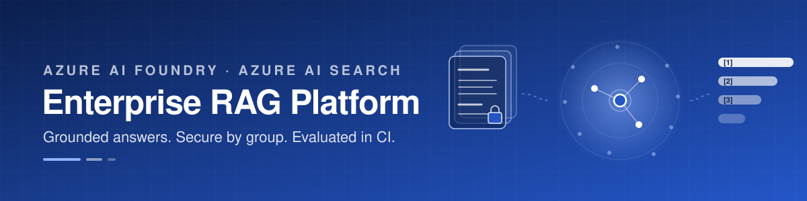
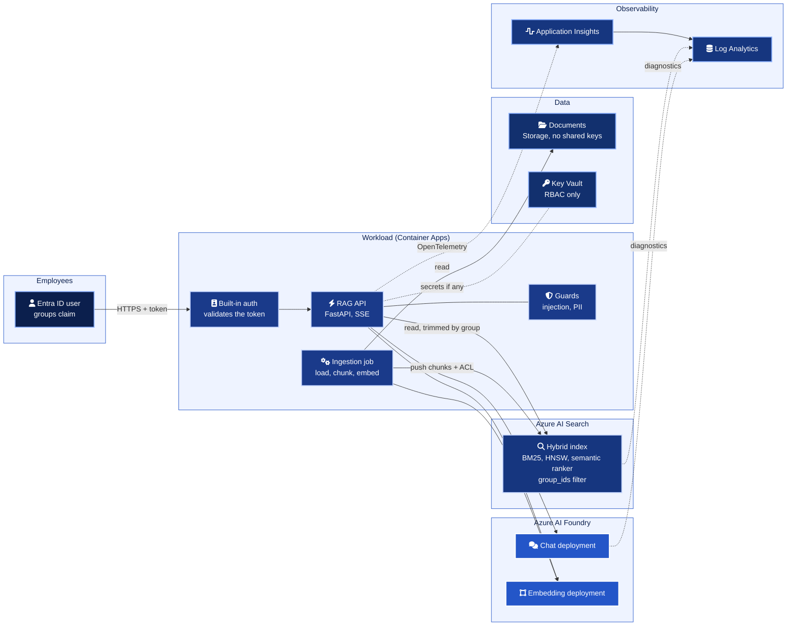
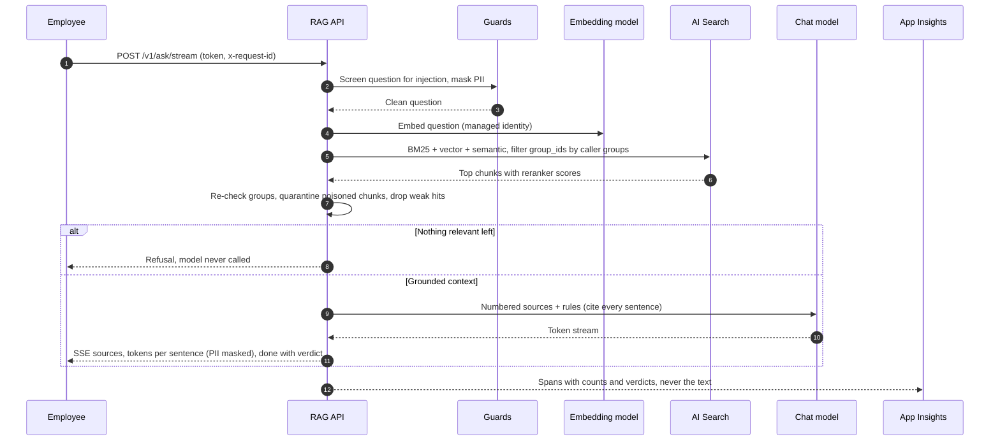
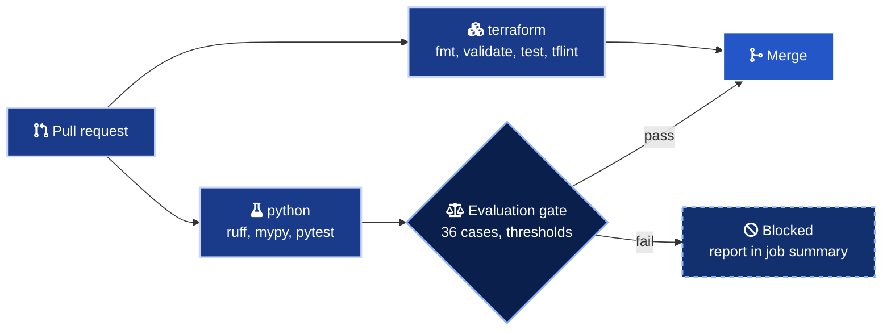

<div align="center">



# Enterprise RAG Platform

Retrieval augmented generation on Azure that answers only from what each employee may read, proves it with numbers, and shows its work in every trace.

<a href="infra/terraform/foundry.tf"></a>
<a href="src/rag/azure/openai.py"></a>
<a href="src/rag/ingestion/index_schema.py"></a>
<a href="docs/security-model.md"></a>
<br>
<a href="infra/terraform/versions.tf"></a>
<a href="pyproject.toml"></a>
<a href="src/rag/api/app.py"></a>
<a href="src/rag/api/telemetry.py"></a>
<a href=".github/workflows/ci.yml"></a>
<a href="LICENSE"></a>

</div>

<br>

## In numbers

| | |
| --- | --- |
| 0 | API keys. Local auth is off on Foundry, AI Search, Storage and Application Insights |
| 0 | Access violations across 36 evaluation cases, gated in CI |
| 1.000 | Recall@5 on the synthetic handbook, offline run [^offline] |
| 0.917 | Refusal accuracy. The service answers if and only if it should [^offline] |
| 4 | Data planes behind private endpoints, with 6 private DNS zones |
| 9 | Role assignments, split between a read only API identity and a write only ingestion identity |
| 24 | Terraform resource blocks over 19 resource types, with 14 validation rules on 15 variables |
| 7 | Offline `terraform test` runs with mocked providers |
| 125 | Python tests, 96 percent branch coverage, no network |
| 15 | STRIDE threats, each mapped to a control and a file |

[^offline]: Offline backend, measured with `rag-eval`. Hashing embedder, in-memory hybrid index and an extractive generator. The numbers measure the pipeline logic on the synthetic set, not the quality of Azure OpenAI or Azure AI Search. Full table in [docs/evaluation.md](docs/evaluation.md).

## What it is

A reference implementation of RAG the way an enterprise needs it. Employees ask questions about internal documents and get short answers where every sentence cites its source. A restricted HR page never reaches someone outside HR, because the search index filters by Entra ID group before ranking and the application checks every hit again. Every change runs an evaluation set in CI, and a drop in retrieval quality or a single access violation blocks the merge.

Everything runs on a laptop with fakes behind the same interfaces, so the logic that matters most is tested without a cloud account.

## Architecture



All data planes sit behind private endpoints in production. The index schema, the chunking and the ACL extraction are code in this repository, explained in [docs/architecture.md](docs/architecture.md).

## How a question is answered



## Evaluation

The gate in CI runs 36 cases through retrieval and generation and fails the build when a metric drops under its threshold. The cases cover answerable questions, questions whose answer exists only in a document the caller may not read, questions nothing answers, and direct injection attempts.

| Metric | Offline result [^offline] | Gate |
| --- | --- | --- |
| Recall@5 | 1.000 | 0.95 |
| MRR | 0.963 | 0.90 |
| nDCG@5 | 0.973 | 0.90 |
| Answer rate (answerable cases) | 0.889 | 0.85 |
| Citation coverage | 1.000 | 0.95 |
| Groundedness, lexical | 1.000 | 0.95 |
| Expected term recall | 0.958 | 0.90 |
| Refusal accuracy | 0.917 | 0.88 |
| Access violations | 0 | 0 |

Citation coverage and groundedness are 1.0 by construction with an extractive generator. They become informative against a real model, where the optional LLM judge also applies.

> [!TIP]
> The same harness compares strategies. Fixed size chunking ranks slightly better on this set but answers fewer questions (0.815) and quarantines 19 chunks instead of 6, because a poisoned sentence contaminates every window around it. It fails the gate. Details in [docs/evaluation.md](docs/evaluation.md).

## Quick start

Everything below runs offline, with no Azure subscription.

```bash
git clone https://github.com/marlyngiselle/enterprise-rag-platform.git
cd enterprise-rag-platform
python3.12 -m venv .venv
.venv/bin/pip install -e ".[dev]"

# Quality checks and the evaluation gate
.venv/bin/ruff check . && .venv/bin/mypy && .venv/bin/pytest
.venv/bin/rag-eval && cat reports/eval-report.md

# Run the API on the synthetic handbook
RAG_AUTH_MODE=dev-headers .venv/bin/uvicorn --factory rag.api.app:app_factory --port 8080
```

In a second terminal, ask the same question as two different employees.

```bash
curl -s localhost:8080/v1/ask -H 'content-type: application/json' \
  -H 'x-user-id: alex' -H 'x-user-groups: all-employees,hr-compensation' \
  -d '{"question": "What is the merit increase budget for 2026?"}'

curl -s localhost:8080/v1/ask -H 'content-type: application/json' \
  -H 'x-user-id: sam' -H 'x-user-groups: all-employees' \
  -d '{"question": "What is the merit increase budget for 2026?"}'
```

The first gets the answer with a citation to the compensation review. The second gets a refusal, and the model is never called.

Infrastructure checks, also offline.

```bash
terraform -chdir=infra/terraform init -backend=false
terraform -chdir=infra/terraform validate
terraform -chdir=infra/terraform test
tflint --chdir=infra/terraform --config="$PWD/.tflint.hcl" --init
tflint --chdir=infra/terraform --config="$PWD/.tflint.hcl"
```

To deploy, copy `infra/terraform/backend.hcl.example` to `backend.hcl` with your state storage account, then run from a machine with access to Azure.

```bash
az login
export TF_VAR_subscription_id="$(az account show --query id -o tsv)"
terraform -chdir=infra/terraform init -backend-config=backend.hcl
terraform -chdir=infra/terraform plan -var-file=env/dev.tfvars -out=tfplan
terraform -chdir=infra/terraform apply tfplan

export RAG_BACKEND=azure
export RAG_OPENAI_ENDPOINT="$(terraform -chdir=infra/terraform output -raw openai_endpoint)"
export RAG_SEARCH_ENDPOINT="$(terraform -chdir=infra/terraform output -raw search_endpoint)"
.venv/bin/rag-ingest --backend azure
.venv/bin/rag-eval --backend azure --no-gate
```

## Environments

| Setting | dev | prd |
| --- | --- | --- |
| Network | Public endpoints, IP allowlist, Entra ID still required | Private endpoints and private DNS, public access disabled |
| AI Search | `basic`, 1 replica, semantic ranker free plan | `standard`, 3 replicas (read and write SLA), semantic ranker standard |
| Model deployments | `GlobalStandard`, 30k tokens per minute | `DataZoneStandard`, 150k tokens per minute |
| Document storage | LRS | ZRS |
| Log retention | 30 days | 90 days |

## Access model

| Identity | AI Search | Foundry models | Documents | Key Vault | App Insights |
| --- | --- | --- | --- | --- | --- |
| API | Index Data Reader | OpenAI User | none | Secrets User | Metrics Publisher |
| Ingestion job | Index Data Contributor, Service Contributor | OpenAI User | Blob Data Reader on `documents` | none | Metrics Publisher |
| Employee | through the API only, trimmed by group | none | none | none | none |

The API cannot write to the index, so a compromised API cannot plant content for other users. The `terraform test` suite asserts it. The full model, with network and guard hooks, is in [docs/security-model.md](docs/security-model.md).

## Delivery



Every action is pinned to a commit SHA, checkout keeps no credentials, and the workflow token is read only. The evaluation report is published as a job summary and kept as an artifact for 30 days.

## Before you deploy

> [!IMPORTANT]
> Group based trimming needs the `groups` claim in the token. Users in more than about 200 groups receive an overage pointer instead, and the API answers 403 rather than guessing. Resolve groups server side through Microsoft Graph, or switch to app roles.

> [!WARNING]
> `RAG_AUTH_MODE=dev-headers` trusts the `x-user-groups` header. It exists for local runs. In Azure, keep the default `easy-auth` and restrict ingress to the built-in authentication front door.

> [!WARNING]
> Model deployments consume regional quota. If the region has no capacity left for a model, the apply fails with `InsufficientQuota`. Check quota before changing `chat_model` or `embedding_model`.

> [!CAUTION]
> Key Vault, the storage account and the documents container carry `prevent_destroy`. Key Vault and Foundry are soft deleted, and the random suffix in their names lets a rebuild proceed while the deleted copy still holds the old name.

## Repository map

| Path | What it holds |
| --- | --- |
| [`src/rag/ingestion/`](src/rag/ingestion) | Loaders (Markdown, HTML, PDF), heading and fixed chunkers, pipeline, index schema as code |
| [`src/rag/retrieval/`](src/rag/retrieval) | Security filter, reciprocal rank fusion, retriever with the second group check, citations |
| [`src/rag/generation/`](src/rag/generation) | Grounded prompt, injection and PII guards, answer service with streaming |
| [`src/rag/evaluation/`](src/rag/evaluation) | Metrics, harness, Markdown report, CI gate, optional LLM judge |
| [`src/rag/api/`](src/rag/api) | FastAPI app, Entra ID principal parsing, OpenTelemetry |
| [`src/rag/azure/`](src/rag/azure) | Keyless Azure OpenAI and AI Search adapters |
| [`src/rag/fakes.py`](src/rag/fakes.py) | Offline embedder, in-memory hybrid index, extractive generator |
| [`data/knowledge-base/`](data/knowledge-base) | Synthetic handbook, 11 documents, one restricted, one poisoned, one without ACL |
| [`data/eval/`](data/eval) | Evaluation set and gate thresholds |
| [`infra/terraform/`](infra/terraform) | Foundry, models, AI Search, storage, Key Vault, identities, RBAC, network, diagnostics |
| [`tests/`](tests) | Unit and API tests, all offline |
| [`docs/`](docs) | Architecture, security model, evaluation, threat model, ADRs |

## Documentation

| Document | What it answers |
| --- | --- |
| [Architecture](docs/architecture.md) | Components, ingestion, index schema, query path, streaming, offline mode |
| [Security model](docs/security-model.md) | Document level trimming, network, identities and roles, guard hooks |
| [Evaluation](docs/evaluation.md) | The set, the metrics, the offline results and how the gate works |
| [Threat model](docs/threat-model.md) | STRIDE for RAG, including prompt injection and data exfiltration |
| [ADR 0001](docs/adr/0001-hybrid-retrieval-with-semantic-ranker.md) | Why hybrid retrieval with semantic reranking |
| [ADR 0002](docs/adr/0002-security-trimming-in-the-index.md) | Why trimming in the index and again in the app |
| [ADR 0003](docs/adr/0003-push-ingestion-from-a-pipeline.md) | Why push ingestion instead of indexers |

<br>

<div align="center">

Designed and built by Giselle Da Costa. Released under the [MIT License](LICENSE).

</div>
